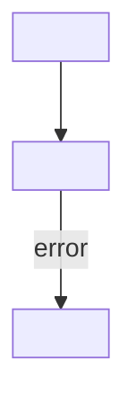

# <title>

## Simple summary

<Three to five sentences: what it does, its input, its output, and what it
does not do.>

## A concrete example

This example is invented. The ids and hosts are not real.

```
<request, message, command or input>
```

## The exact path

1. [`<function>()`](<relative/path#Lnn>) <does one thing>.
2. ...

## Diagram



## What comes out

<The shape of the result, with an example.>

## Failure and edge cases

- <retries, timeouts, duplicates, what is not atomic, a likely wrong assumption>

## Next

- [<next file>](<file>.md)

## Quiz

1. **Easy.** <a fundamental: what it does, its input or its output>
2. **Easy.** <a fundamental>
3. **Medium.** <a concept it uses, or trace one concrete case through it>
4. **Medium.** <a concept, or trace a case>
5. **Hard.** <the behavior it affects elsewhere, or a failure or edge case>
6. **Hard.** <what would break without it, or a trade-off against another design>

<details>
<summary>Check your answers</summary>

1. <answer, the reason, the code reference, and what a common wrong answer misses>
2. ...
</details>
