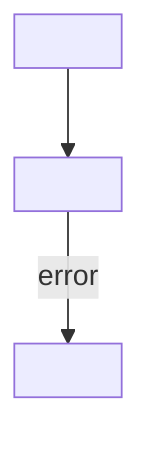

# <title>

## Simple summary

<Three to five sentences: what it does, its input, its output, and what it
does not do.>

## A concrete example

This example is invented. The ids and hosts are not real.

```
<request, message, command or input>
```

## The exact path

1. [`<function>()`](<relative/path#Lnn>) <does one thing>.
2. ...

## Diagram



## What comes out

<The shape of the result, with an example.>

## Failure and edge cases

- <retries, timeouts, duplicates, what is not atomic, a likely wrong assumption>

## Next

- [<next file>](<file>.md)

## Quiz

1. **Easy.** <recall a fact>
2. **Easy.** <recall a fact>
3. **Medium.** <trace a flow or explain a reason>
4. **Medium.** <trace a flow or explain a reason>
5. **Hard.** <predict behaviour in a failure or edge case>
6. **Hard.** <compare two designs or find the trap>

<details>
<summary>Check your answers</summary>

1. <answer, the reason, and the code reference>
2. ...
</details>
